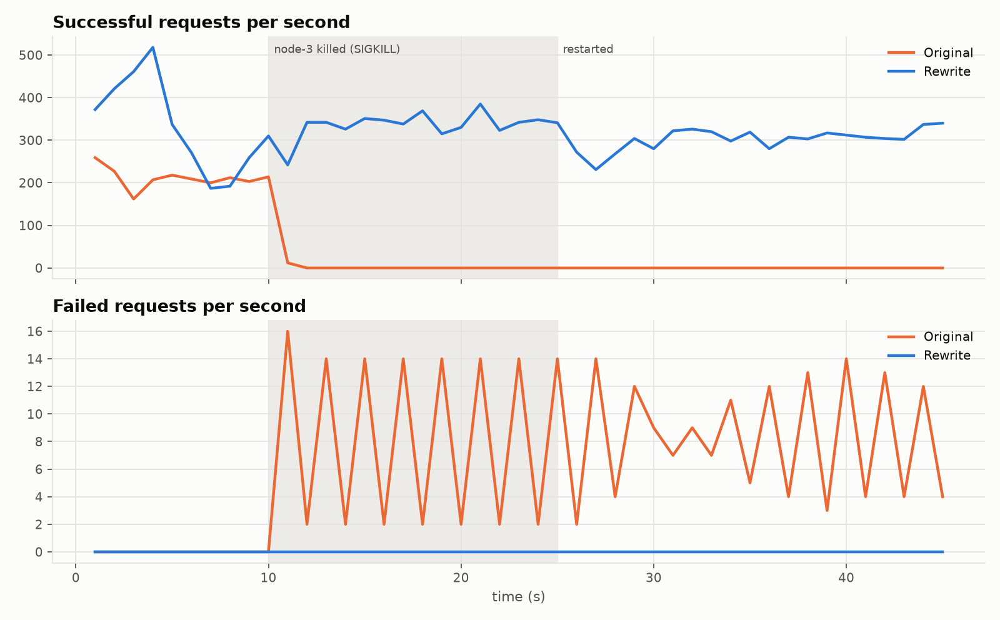

# Dynamo-style distributed key-value store

[](https://github.com/jainilbavishi24/dynamo_db/actions/workflows/ci.yml)


A leaderless, highly available key-value store in Python and gRPC that
implements the core of Amazon's
[Dynamo paper](https://www.allthingsdistributed.com/files/amazon-dynamo-sosp2007.pdf):

| Technique | What it gives you | Where |
|---|---|---|
| Consistent hashing with virtual nodes | Even data placement; adding a node moves ~1/n of keys | [`ring.py`](dynamo/ring.py) |
| Quorum replication (N, R, W) | Tunable consistency vs. latency/availability | [`node.py`](dynamo/node.py) |
| Dotted version vectors | Detects concurrent writes as siblings, without the lost updates plain vector clocks allow | [`versioning.py`](dynamo/versioning.py) |
| Sloppy quorum + hinted handoff | Writes keep succeeding while replicas are down and are handed back on recovery | [`node.py`](dynamo/node.py), [`storage.py`](dynamo/storage.py) |
| Read repair | Stale replicas are fixed in the background after reads | [`node.py`](dynamo/node.py) |
| Gossip membership + failure detection | No coordinator; join, leave, crash and partition healing | [`membership.py`](dynamo/membership.py) |
| Durable storage | One atomically replaced file per key; survives crashes | [`storage.py`](dynamo/storage.py) |

This repository started as a course project. An audit of the original
implementation found 35 correctness, performance and tooling problems,
including a self-deadlock (re-acquiring a non-reentrant lock) that let a
single node crash freeze the whole cluster. All are documented in [**docs/BUG_AUDIT.md**](docs/BUG_AUDIT.md).
The system was rewritten with a test suite and reproducible experiments.

## Results

Measured on one 4-core laptop, with every node a separate process and the
original implementation run from its own commit under the same load
([method and raw data](experiments/README.md)).

| | Original | Rewrite |
|---|---:|---:|
| Median latency, 1 client | 55.4 ms | **5.2 ms** (10× lower) |
| Throughput, 16 clients | 199 ops/s | **328 ops/s** (1.65×) |
| Requests served after one of 3 nodes crashes | **0** (cluster deadlocks) | **all of them** (0 of 14,418 failed) |
| Time to hand writes back to a restarted node | never | **0.5 s** (1,477 hinted keys) |
| Requests failing with a node down, R=3/W=3 on 4 nodes | not measured (it has no sloppy quorum) | **0** |
| Test suite | 21 of 58 failing; does not finish without timeouts | **162 passing in ~30 s, 20/20 clean runs** |



The original stops serving about a second after node-3 is killed and never
recovers ([why](docs/BUG_AUDIT.md#the-most-severe-one)); the rewrite keeps
serving through the crash and the restart.

| Experiment | Question | Headline |
|---|---|---|
| [E1](experiments/README.md#e1-original-vs-rewrite) | Original vs. rewrite under the same load | 1.65× throughput, 1.9× lower median latency |
| [E2](experiments/README.md#e2-concurrency-scaling) | Scaling from 1 to 64 clients | 10× lower latency at low load; saturates at ~4 clients on 4 cores |
| [E3](experiments/README.md#e3-quorum-trade-offs) | Cost and availability of (R, W) choices | GET cost follows R, PUT cost follows W; 100 % available with a node down |
| [E4](experiments/README.md#e4-crash-and-recovery) | Crash and recovery under load | 0 failed requests; replicas identical 0.5 s after restart |
| [E5](experiments/README.md#e5-virtual-nodes-and-load-balance) | How many virtual nodes? | 64 keeps the busiest node within ~20 % of average; a join moves 11 % of keys (mod-N hashing: 89 %) |
| [E6](experiments/README.md#e6-cost-of-fsync) | Cost of fsync per write | 18× slower storage write, −26 % end-to-end write throughput |

## Quick start

Requires Python 3.10+.

```bash
git clone https://github.com/jainilbavishi24/dynamo_db.git && cd dynamo_db
make install                 # creates .venv and installs the package + dev tools

make cluster                 # 3 local nodes on ports 50051-50053
.venv/bin/dynamo-cli put user:42 alice
.venv/bin/dynamo-cli get user:42
.venv/bin/dynamo-cli members
make stop
```

If port 50051 is taken, use another base port:
`BASE_PORT=52051 make cluster`, then `dynamo-cli --seeds localhost:52051 ...`.

Or watch every technique on a live 4-node cluster, step by step
(crash a node, keep writing, restart it, create and resolve a conflict):

```bash
./scripts/demo.sh            # AUTO=1 ./scripts/demo.sh to run without pauses
```

<details>
<summary>Example session</summary>

```text
$ dynamo-cli put user:42 alice
OK  [coordinator localhost:50053]
$ dynamo-cli get user:42
user:42: 1 version  [coordinator localhost:50052]
  [0] 'alice'  clock={node-3:1}

# two clients update the same version concurrently ...
$ dynamo-cli get cart
cart: 2 versions (concurrent siblings)  [coordinator localhost:50052]
  [0] 'apples'  clock={node-1:2, node-4:3}
  [1] 'bananas'  clock={node-1:2, node-3:4}
$ dynamo-cli resolve cart apples+bananas
OK  superseded 2 version(s)  [coordinator localhost:50052]
$ dynamo-cli get cart
cart: 1 version  [coordinator localhost:50054]
  [0] 'apples+bananas'  clock={node-1:2, node-2:2, node-3:4, node-4:3}
```

</details>

## Using it

### Server

```bash
dynamo-server --id node-1 --port 50051
dynamo-server --id node-2 --port 50052 --seeds localhost:50051
dynamo-server --id node-3 --port 50053 --seeds localhost:50051 --host 10.0.0.3
```

| Flag | Default | Meaning |
|---|---|---|
| `-n / -r / -w` | 3 / 2 / 2 | Replication factor, read quorum, write quorum |
| `--seeds` | none | Existing nodes to join through |
| `--host` | `localhost` | Address advertised to peers (set this on a real network) |
| `--data-dir` | `data` | Persistent state (`''` for in-memory) |
| `--vnodes` | 64 | Virtual nodes per physical node |
| `--fsync` | off | fsync every write (see experiment E6) |
| `--gossip-interval` / `--fail-timeout` | 1 s / 5 s | Gossip period, heartbeat timeout before a peer is considered dead |
| `--remove-timeout` | 120 s | How long a dead node keeps its ring position |

Stop a node with `SIGTERM` / Ctrl-C for a graceful shutdown.

### Client library

```python
from dynamo.client import DynamoClient

with DynamoClient(["localhost:50051"]) as db:
    db.put("cart:42", "apples")

    result = db.get("cart:42")              # discovers the cluster and fails over
    if result.has_conflict:                 # concurrent writes -> siblings
        merged = ",".join(sorted(v.text for v in result.versions))
        db.put("cart:42", merged, context=result.context)   # supersedes all siblings
```

`put` without a context overwrites what the cluster currently holds; with
the context from a `get` it supersedes exactly what was read, so a
concurrent writer's value is kept as a sibling instead of being lost.
Quorum failures raise `QuorumUnavailable`.

### CLI

`dynamo-cli [--seeds host:port,...] COMMAND`, or no command for an
interactive shell:

| Command | |
|---|---|
| `put KEY VALUE` | Write (exit 0) |
| `get KEY` | Read; prints all siblings with their clocks (exit 1 if not found) |
| `resolve KEY VALUE` | Read, then write with the merged context, replacing all siblings |
| `members` | Cluster membership |
| `leave NODE_ID` | Decommission a node (restarting it rejoins) |

Exit code 3 means the cluster could not reach a quorum.

## How it works

A client can send a request to **any** node; that node becomes the
*coordinator*, finds the key's N replicas on the hash ring, sends the
operation to them in parallel and answers as soon as R (reads) or W (writes)
have responded. Replicas the failure detector considers dead are replaced
by the next healthy nodes on the ring, which keep the write as a *hint* and
deliver it when the replica comes back. Reads reconcile versions with
dotted version vectors and return concurrent versions as siblings; stale
replicas are repaired in the background.

[**docs/DESIGN.md**](docs/DESIGN.md) has the full design with sequence
diagrams, including why plain vector clocks were replaced by dotted version
vectors, and the limitations (no Merkle-tree anti-entropy, no deletes, no
TLS).

## Testing

```bash
make test            # ruff + 162 tests (~30 s)
```

| Suite | Tests | What |
|---|---|---|
| `tests/unit` | 115 | Clocks, reconciliation, ring, storage, membership (with fake clocks) |
| `tests/integration` | 43 | Real gRPC clusters in-process: quorums, handoff, read repair, conflicts, join/leave, restarts |
| `tests/e2e` | 4 | Real server processes driven through the CLI |

The suite was run 20 times in a row without a failure. See
[docs/TESTING.md](docs/TESTING.md) for the strategy and the latest run in
[docs/TEST_REPORT.md](docs/TEST_REPORT.md).

## Experiments

All numbers come from `make experiments` (`python -m benchmarks.run_experiments all`),
which launches real server processes and a multi-process closed-loop load
generator. The full write-up, with method and raw data, is in
[**experiments/README.md**](experiments/README.md).

## Project layout

```text
dynamo/                 the package
  node.py               coordinator + replica + background loops
  membership.py         gossip, failure detection, join/leave
  ring.py               consistent hashing
  versioning.py         dotted version vectors, reconciliation
  vector_clock.py
  storage.py            per-key durable storage, hint store, durable counter
  rpc.py                pooled gRPC channels
  server.py / client.py entry points (dynamo-server / dynamo-cli)
  proto/dynamo.proto    wire protocol (+ generated bindings)
tests/                  unit / integration / e2e
benchmarks/             load generator, cluster harness, experiments, plots
experiments/            results, charts and the experiment log
scripts/                start/stop a local cluster, guided demo
docs/                   design, bug audit, testing, test report
```

## References

- G. DeCandia et al. *Dynamo: Amazon's Highly Available Key-value Store.* SOSP 2007.
- N. Preguiça et al. *Dotted Version Vectors: Logical Clocks for Optimistic Replication.* 2010. [arXiv:1011.5808](https://arxiv.org/abs/1011.5808)
- R. van Renesse et al. *A Gossip-Style Failure Detection Service.* Middleware 1998.
